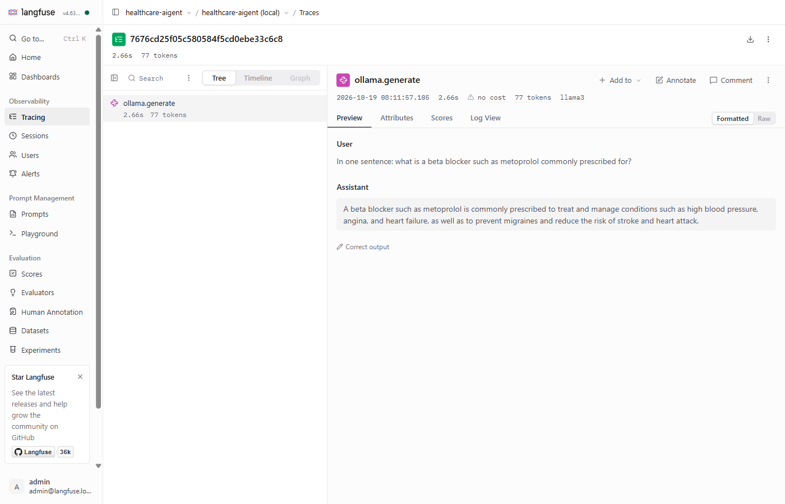

# Langfuse (local, self-hosted) — LLM observability

Exploration tracked in epic #10. This page covers what has landed so far:

- **#11** — a local Langfuse stack via Docker Compose
- **#12** — optional, default-off Langfuse settings in the LLM config layer
- **#13** — every `BaseLLM` call recorded as one Langfuse *generation* (model, prompt, completion, tokens, latency)

Tracing the full pipeline as one trace (#14), cost dashboards (#15) and PII masking (#16) are not built yet.

> **Privacy.** Until #16 adds client-side masking, enabled tracing sends prompts and model output
> to Langfuse **unmasked**. Keep the stack local (the compose file binds every port to
> `127.0.0.1`) and use synthetic conversations only. Tracing is off unless you turn it on.

## 1. Run Langfuse locally (#11)

Prerequisites: Docker with Compose v2. The stack is Langfuse web + worker, Postgres,
ClickHouse, Redis and MinIO (S3). It uses about **2.8 GiB RAM** when idle, plus about 2 GB of images on first pull.

```bash
docker compose -f docker-compose.langfuse.yml up -d      # start (first boot ~1 min, later ~20 s)
docker compose -f docker-compose.langfuse.yml ps         # all services should be healthy
curl http://localhost:3000/api/public/health             # -> {"status":"OK","version":"4.63.0"}
```

Open <http://localhost:3000> and log in. On first boot the stack bootstraps an org, a
project and API keys, so there is no sign-up step:

| What | Value (local-dev default) |
|---|---|
| Login | `admin@langfuse.local` / `langfuse-local-dev` |
| Project | `healthcare-aigent (local)` (id `healthcare-aigent-local`) |
| Public key | `pk-lf-local-dev` |
| Secret key | `sk-lf-local-dev` |

The keys are also visible under *Project settings → API keys*. To check them from a shell:

```bash
curl -u pk-lf-local-dev:sk-lf-local-dev http://localhost:3000/api/public/projects
```

Stop and reset:

```bash
docker compose -f docker-compose.langfuse.yml down      # stop, keep traces
docker compose -f docker-compose.langfuse.yml down -v   # reset: delete all data; keys are re-created on next up
```

To change ports, login or secrets, copy `.env.langfuse.example` to `.env.langfuse` (gitignored)
and add `--env-file .env.langfuse` to the commands above. Bootstrap values only apply to an
empty database, so run `down -v` after changing them.

Ports: UI on `127.0.0.1:3000`, MinIO on `127.0.0.1:9190`. MinIO is only used for media
attachments. Postgres, ClickHouse and Redis are not published, so they cannot clash with
another stack that uses 5432/6379.

**Scope:** this is a local exploration stack. The secrets are well-known defaults, and there
is no TLS, backups or SSO. A real deployment would go through `ansible/` and is out of scope for #10.

## 2. Turn tracing on (#12)

Install the optional extra, then set the env vars (see `.env.example`):

```bash
uv sync --extra observability
```

| Env var | Default | Meaning |
|---|---|---|
| `LANGFUSE_ENABLED` | `false` | Master switch. When false nothing is traced and `langfuse` is never imported. |
| `LANGFUSE_HOST` | `http://localhost:3000` | Langfuse base URL |
| `LANGFUSE_PUBLIC_KEY` / `LANGFUSE_SECRET_KEY` | unset | Project API keys. If either is missing, tracing stays off with one warning. |
| `LANGFUSE_SAMPLE_RATE` | `1.0` | Fraction of traces to keep |
| `LANGFUSE_DEBUG` | `false` | SDK debug logging |

The same keys can be set in `config/llm_config.json` under `"langfuse"`, like the `openai`/`ollama`
sections. In code, `src.llm.observability.get_langfuse_client()` returns the shared client, or
`None` when tracing is off, keys are missing, or the extra is not installed. It never raises.

> `langfuse` and `langflow` cannot be installed together: `langflow` pins `langfuse==2.53.9`.
> `langflow` is therefore an optional extra too (`uv sync --extra langflow`, only needed for
> `src/langflow_poc/`), and the two extras are declared as conflicting in `pyproject.toml`.

## 3. Your first trace (#13)

Start Ollama first (the Ollama app, or `ollama serve`); check it with
`curl http://localhost:11434/api/version`. Then pull the default model:

```bash
ollama pull llama3.1:8b
```

`llama3.1:8b` is the default because it is the base model of Juvoly J1 (`Juvoly/J1-Llama-8B-exp`,
#2): the same architecture, prompt template and tokenizer, so swapping in J1 later only changes
`--model`. J1 itself is not the default, because it is published only as fp16 safetensors
(~16 GB, gated) and has to be imported into Ollama first.

```bash
LANGFUSE_ENABLED=true LANGFUSE_PUBLIC_KEY=pk-lf-local-dev LANGFUSE_SECRET_KEY=sk-lf-local-dev \
  uv run python scripts/langfuse_smoke.py --provider ollama --model llama3.1:8b
```

PowerShell:

```powershell
$env:LANGFUSE_ENABLED="true"; $env:LANGFUSE_PUBLIC_KEY="pk-lf-local-dev"; $env:LANGFUSE_SECRET_KEY="sk-lf-local-dev"
uv run python scripts/langfuse_smoke.py --provider ollama --model llama3.1:8b
```

Windows cmd:

```bat
set LANGFUSE_ENABLED=true
set LANGFUSE_PUBLIC_KEY=pk-lf-local-dev
set LANGFUSE_SECRET_KEY=sk-lf-local-dev
uv run python scripts/langfuse_smoke.py --provider ollama --model llama3.1:8b
```

It prints the token usage, the answer, and a `trace_url=` you can open. Without
`LANGFUSE_ENABLED` the same command still calls the LLM and prints `langfuse=disabled (no trace sent)`.



What is recorded per call:

| Field | Source |
|---|---|
| name | `<provider>.generate`, e.g. `ollama.generate` |
| model, temperature | the `BaseLLM` instance |
| input / output | prompt / completion text |
| usage (input/output tokens) | LangChain `usage_metadata` from the provider response (Ollama and OpenAI) |
| latency | measured by the SDK |
| level ERROR + message | when the provider call raises (the exception is re-raised unchanged) |

How it hooks in: `BaseLLM.invoke`, `ainvoke`, `generate` and `__call__` all go through
`BaseLLM._traced_call`, which hands off to `src.llm.observability.observe_llm_call`. Every
provider, including the adapter-backed ones, is covered without provider-specific tracing code.

**Cost:** local models show *no cost*, because Langfuse has no price for `llama3.1:8b`. OpenAI models
should get a cost from Langfuse's built-in price list, but this has not been verified here (no
OpenAI key was available). Adding custom prices for local models is #15.

### Reading traces from the API (Langfuse v4)

Langfuse v4 runs in *events_only* mode, and the classic `GET /api/public/traces/{id}` returns
"not available". Use the Observations API v2 instead:

```bash
curl -u pk-lf-local-dev:sk-lf-local-dev \
  "http://localhost:3000/api/public/v2/observations?traceId=<trace_id>&fields=core,basic,usage,io,model&limit=10"
```
